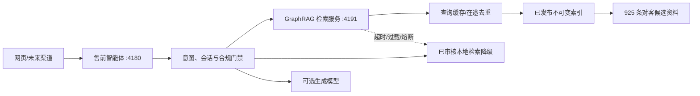

# 华美售前智能体 GraphRAG 交付说明

## 1. 交付结论

本期已完成“售前智能体＋独立 GraphRAG 检索服务”的可运行交付版，暂不把企业微信等外部渠道纳入本次验收。当前一期容量验收门槛调整为 20 名用户并发；此前关闭外部大模型生成时完成的 500 名用户突发压测仅保留为历史工程基线。

当前默认启用的是“安全预构建图索引”：所有资料在本地进行实体、关系、中文词项和来源路径索引，在线服务不需要外部模型即可检索。官方 Microsoft GraphRAG 3.1.1 依赖、配置、输入、查询适配器和发布脚本已就绪；由于全量官方建图会把准入资料发送给配置的模型供应商并产生费用，只能在客户确认数据出域、模型、向量模型和预算后执行最后一次正式索引发布。

## 2. 运行架构

关键设计：

- 离线构建、在线只读。在线请求不参与抽取、分块、建图或发布。
- 日常对话默认使用 local search；global search 在本地预构建引擎中明确禁用，避免高费用 map-reduce 进入每轮对话。
- 单进程最大 128 个在途检索，容器默认 4 个工作进程，编排示例为 2 个副本。
- 缓存键包含租户、索引版本、知识发布版本、查询和过滤条件，防止跨租户或跨版本复用。
- GraphRAG 超时、拒绝、结构异常或连续失败时，自动切回原有已审核检索，不将依赖故障直接暴露给用户。
- GraphRAG 证据会再经“租户＋知识包版本＋三审发布记录”检查，非准入记录不会进入生成上下文。

## 3. 知识数据边界

原始知识包共 7,127 条记录。对客索引纳入 925 条，剔除 6,202 条：

- 6,157 条脱敏运营汇总不进入终端客户检索。
- 8 条目录信息和 37 条 OCR 资料因聊天记录、前后对比、客户画像、案例库或术前术后路径被强制隔离。
- 当前索引包含 464 个实体、2,812 条关系和 197,902 个中文检索词项。
- 价格、政策、活动和套餐资料统一标记“历史资料，需核验当前价格、有效期、包含项和限制条件”。

活动索引版本：`huamei-v1-bootstrap-20260825.1`。

## 4. 历史 500 并发工程基线与当前 20 并发门槛

| 链路 | 并发用户 | 请求数 | 成功率 | P95 | 吞吐 | 结果 |
|---|---:|---:|---:|---:|---:|---|
| GraphRAG 检索层 | 500 | 1,000 | 100% | 513.96 ms | 1,279.64 req/s | 通过 |
| 售前智能体完整链路 | 500 | 500 | 100% | 1,440.52 ms | 326.62 req/s | 通过 |

验收阈值：错误率不高于 0.5%；GraphRAG P95 不高于 2 秒；完整售前链路 P95 不高于 10 秒。

完整链路验收覆盖意图识别、会话状态、已审核本地检索、GraphRAG、合规门禁和回复组装，外部生成模型关闭。启用外部生成模型后，当前一期仅要求在真实模型和正式知识版本下完成 20 并发、稳态 30 分钟的生产验收；历史 500 用户首请求同时突发结果不替代该验收。

详细报告：`artifacts/graphrag-load-500.json` 和 `artifacts/acquisition-agent-load-500.json`。

## 5. 服务与配置

GraphRAG 服务默认端口为 4191（4190 属于浏览器/Node 安全禁止端口，本项目不使用）。

- `GET /health`：存活状态。
- `GET /ready`：索引就绪状态。
- `GET /metrics`：请求、过载、缓存、延迟和并发指标。
- `POST /v1/retrieve`：租户隔离的本地图检索。

核心环境变量：

- `HUAMEI_GRAPHRAG_ENABLED=true`
- `HUAMEI_GRAPHRAG_URL=http://127.0.0.1:4191`
- `HUAMEI_GRAPHRAG_ENGINE=auto|bootstrap|official`
- `HUAMEI_GRAPHRAG_MAX_CONCURRENCY=128`
- `HUAMEI_GRAPHRAG_TIMEOUT_MS=1500`
- `HUAMEI_GRAPHRAG_SERVICE_KEY=<独立强密钥>`

## 6. 知识发布流程

1. 在建图之外完成脱敏、公共准入、价格/政策时效说明和业务/医务/合规三审，产出唯一不可变的 `huamei-public-safe.jsonl`。仓库现有925条是开发候选目录，不等同于正式三审放行。
2. 用 `build_bootstrap_index.py` 验证每条canonical字段、声明SHA、确定性`text`与公共准入规则，然后从同一目录建图；脚本不得截断、补写、重算或重新序列化受审字段。
3. 验证目录原始字节 SHA-256、批准记录集 SHA、记录数、实体数和关系数；Node fallback与Python GraphRAG必须得到完全相同的包/记录集摘要。
4. 三审通过后，由知识发布 API 激活租户的 `approved_record_ids`，active release同时锚定目录SHA和批准记录集SHA。
5. 如需官方 LLM 抽取图，在隔离的离线环境填写 `graphrag_project/.env`，明确数据出域与费用授权，再执行 `build_official_index.py`。`--knowledge-package`必须与项目公共目录逐字节一致，脚本在缺少显式授权或绑定不一致时拒绝运行。
6. 新索引先通过评测集和并发验收，再切换活版本；旧版本保留用于回滚。

## 7. 交付物清单

- `graphrag-service/app/`：检索 API、引擎、缓存、并发、指标和官方 GraphRAG 适配器。
- `graphrag-service/data/indexes/`：已发布不可变索引、清单和当前版本指针。
- `graphrag-service/graphrag_project/`：官方 GraphRAG 3.1.1 配置、提示词和 925 条安全输入。
- `graphrag-service/scripts/`：预构建索引和官方索引发布脚本。
- `graphrag-service/Dockerfile`：只读多进程查询镜像。
- `server/graphrag-client.mjs`：售前智能体中的 GraphRAG 调用、在途去重、熔断和降级。
- `graphrag-service/loadtest/load_500.py`：文件名为历史兼容保留，默认执行 20 并发验收脚本。
- `deploy/docker-compose.example.yml`：GraphRAG、售前智能体、网页应用和网关的部署编排示例。

## 8. 上线前仍需外部确认的门禁

- 正式对客知识的业务、医务、合规三审名单。
- 官方 GraphRAG 建图的模型供应商、数据出域合规、费用预算和嵌入模型。
- 生成模型的 20 并发/RPM/TPM 正式配额。
- 生产环境的长时压测、故障注入、监控告警和恢复演练。
