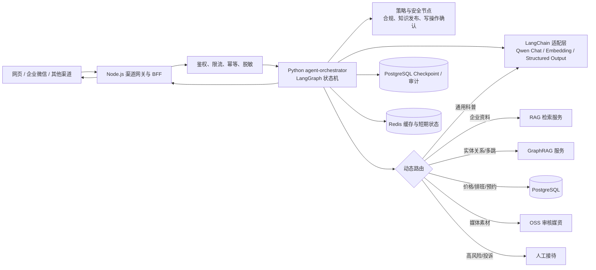
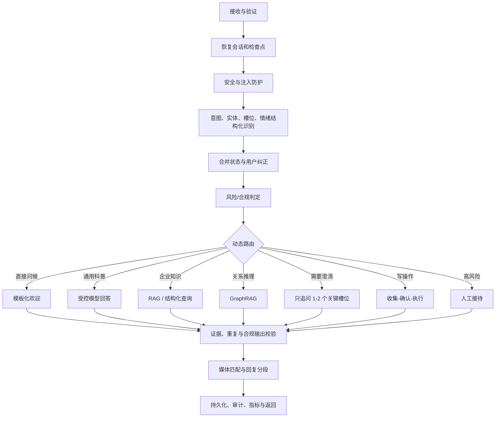

# 华美一期售前智能体 LangChain / LangGraph 重构技术设计

**状态：** 已被 V2.0 修订稿替代；仅保留作历史设计记录。实施以 [V2.0 修订稿](./LANGCHAIN_LANGGRAPH_REFACTOR_DESIGN_V2.md) 为准。
**适用分支：** `refactor/langchain-langgraph`  
**目标：** 在不破坏现有前台、管理后台和渠道接入契约的前提下，将售前对话编排从 Node.js 内部规则编排，渐进重构为基于 LangGraph 的可恢复状态机；使用 LangChain 统一模型、检索器和工具适配。

## 1. 设计结论

采用“**Node.js 边界层保留 + Python LangGraph 编排服务新增 + 既有知识和治理服务复用**”的渐进架构，而不是一次性重写。

- Node.js 继续承接网页、企业微信等渠道协议、管理后台 BFF、身份认证、限流、审计入口和兼容 API。
- 新增 Python `agent-orchestrator` 服务作为 LangGraph 运行时，负责多轮状态、意图/槽位/情绪合并、动态路由、受控工具调用和回复生成。
- LangChain 只承担模型、Embedding、Retriever、Tool、结构化输出等标准适配；业务规则、知识发布权限、人工接待和写操作确认不交给“黑盒 Agent”。
- 已有 GraphRAG 服务继续独立运行。只有实体关系、多跳推理、医生—项目—产品等关联问题才由 LangGraph 路由至 GraphRAG；价格、活动、预约、人员排班等时效业务信息优先查询结构化数据。
- 生产环境以 PostgreSQL 为业务与审计真源，Redis 用于限流、短期缓存、LangGraph 检查点加速；图状态不是长期客户资料的唯一存储。

这样可以解决当前规则散落、上下文覆盖、待选择槽位丢失、追问重复、路由不可追溯的问题，同时保持对话 API、管理后台与已上线渠道的稳定。

## 2. 现状与重构边界

当前 Node 服务已具备渠道标准化、会话持久化、意图与待选择槽位、知识发布策略、GraphRAG 客户端、反馈 Bad Case、人工接待、审计和管理后台接口。这些能力不能直接删除。

本次重构替换的是“**对话决策和步骤编排内核**”，不是替换以下系统：

| 保留并复用 | 责任 |
| --- | --- |
| 网页/渠道网关、管理后台 BFF | 对外 API、身份、CORS、限流、分页、运营操作 |
| PostgreSQL 领域数据与知识发布工作流 | 客户、预约、产品、价格、审批、审计的唯一业务真源 |
| 现有 RAG/GraphRAG 服务 | 已审核知识检索、图谱索引与证据校验 |
| OSS 媒资服务 | 审核通过的图片/PDF 预览与引用 |
| 人工接待、预约、反馈 Bad Case | 业务闭环、人工兜底与持续评测 |

## 3. 目标架构



### 3.1 服务职责

| 服务 | 技术 | 职责 | 不负责 |
| --- | --- | --- | --- |
| `web / acquisition gateway` | Node.js | 渠道入站与出站、鉴权、限流、幂等键、管理后台 API、协议兼容 | 医疗问题的决策编排 |
| `agent-orchestrator` | Python + FastAPI + LangGraph | 会话状态机、路由、工具计划、回复和交接决策 | 直接持有客户真源数据 |
| `knowledge / GraphRAG` | 现有 Python 服务 | 审核知识检索、图关系检索、证据返回 | 生成无证据的企业事实 |
| `PostgreSQL` | PostgreSQL | 领域数据、知识版本、会话摘要、审计、审批、检查点 | 向量化全文检索 |
| `Redis` | Redis | 限流、幂等、短缓存、任务队列、检查点加速 | 长期事实和审批记录 |

### 3.2 内部接口契约

Node 网关新增一个内部调用，不改变现有的对外会话接口。

`POST /internal/v1/orchestrate`

输入：`tenant_id`、`conversation_id`、`message_id`、`channel`、用户消息、会话版本、已验证身份范围、幂等键和追踪 ID。  
输出：分段回复、引用、媒体卡片、会话状态补丁、人工接待建议、待确认写操作、证据声明、评测与审计摘要。

内部调用必须使用服务身份、mTLS 或同一私网、请求签名和超时预算；不得把 Qwen Key、原始客户手机号或后台管理员令牌传给模型服务。

## 4. LangGraph 状态设计

每一轮对话使用以下逻辑状态；长期资料仅保留 ID 或脱敏摘要，权威值从 PostgreSQL 读取。

```text
ConversationState
├── request: tenant_id, conversation_id, turn_id, channel, idempotency_key
├── input: normalized_message, attachments, language, received_at
├── session: session_version, active_topic, current_goal, recent_answers
├── understanding: intents[], entities[], emotion, risk_level, confidence
├── slots: known_slots, pending_slot, pending_options, correction_history
├── routing: route, freshness_required, complexity, tool_plan
├── evidence: citations[], claims[], release_id, index_version
├── execution: pending_write, tool_results, handover
├── response: segments[], media[], cards[], suggested_next_step
└── governance: policy_decision, audit_event_ids, trace_id
```

关键约束：

1. `pending_slot` 是一等状态。用户回复“第二种”“自体脂肪方式”“那个水滴形”时，先按待选项映射，不得重新从全局意图分类开始。
2. 用户纠正具有最高优先级。例如“不是假体，是自体脂肪”必须覆盖旧槽位，并记录 `correction_history`。
3. `recent_answers` 记录已告知的风险提示和结论，输出前做语义去重，避免连续两轮重复“需面诊确认”。
4. 每轮以 `turn_id + idempotency_key` 写入；以 `session_version` 乐观锁提交，冲突时重载状态并安全重试，避免并发覆盖。

## 5. LangGraph 节点与路由



### 5.1 路由原则

| 问题类型 | 首选路径 | 约束 |
| --- | --- | --- |
| 问候、服务范围 | 固定话术节点 | 使用已确认的医院欢迎语，不无效反问 |
| 一般医美科普 | 受控 Qwen 回答 | 不宣称医院服务、价格、医生资质；带医疗边界提示 |
| 医生、项目、产品、医院服务 | 已发布内部知识 RAG | 必须有审核版本和可点击引用 |
| 价格、活动、名额、排班、预约状态 | PostgreSQL 元数据查询 | 校验生效时间与权限；不得从向量文本猜测 |
| 医生—项目—产品关联、多跳比较 | GraphRAG | 仅在关系问题且正式索引已准入时使用 |
| 图片、PDF、海报 | 审核媒资查询 | 仅返回发布资产 ID 和 OSS 预览链接 |
| 投诉、严重负面情绪、医疗风险 | 人工接待 | 自动附带会话摘要、证据和已采集字段 |
| 预约、报名、工单等写操作 | 工具工作流 | 预览、确认、幂等执行、可取消或补偿 |

GraphRAG 永远不是默认路径。正式图谱索引未通过审批、索引版本与知识发布版本不一致、返回证据无法校验时，必须失败关闭并降级为“需要人工核验/已发布 RAG”，不可编造关系结论。

## 6. LangChain 适配层

建议采用 Python 3.12、`langgraph`、`langchain-core`、`langchain-openai`、`pydantic`、`FastAPI`。Qwen 通过 OpenAI 兼容端点接入，模型名称、API Key、超时、费用上限和数据出域开关全部环境化、版本化，禁止写死在代码中。

| 适配项 | 使用方式 |
| --- | --- |
| Chat Model | Qwen 对话模型，`with_structured_output(PydanticModel)` 产出意图、槽位、风险等结构化对象 |
| Embedding | Qwen Embedding，仅服务已审批的知识索引构建与检索 |
| Retriever | 封装已有 RAG、GraphRAG、PostgreSQL、OSS 媒资为具名工具 |
| Prompt | 按业务场景、版本、审批状态托管；每次变更可追溯 |
| Tool | Pydantic 输入/输出校验、超时、权限、幂等和审计包装，不允许模型绕过策略直接写库 |
| 输出 | JSON Schema 校验后才转换为前端消息段和媒体卡片 |

不采用自由循环的 ReAct Agent 作为客服主路径。对话图使用明确节点、条件边和最大步数；复杂任务才进入受限规划子图，所有写工具均使用 `interrupt` 暂停等待用户确认。

## 7. 知识、图谱与证据协同

1. 知识文档进入“解析 → 去重 → 科室审核 → 医务/合规审核 → 发布”的版本化流程。
2. RAG 只读取当前租户、当前生效、允许客户展示的发布集。
3. 图谱从同一发布集构建实体、关系、来源段落、有效期和版本；每条图关系回指知识单元 ID 与原文片段。
4. `release_id + index_version + checksum` 必须三方匹配，GraphRAG 才可被路由使用。
5. 对客户展示的企业事实必须带引用；模型推断、常识科普和业务建议在语义上明确区分。
6. 客户聊天、联系方式、病例资料、内部经营资料不进入通用向量库或图谱。

## 8. 写操作与人机协同

写操作统一采用四段式状态机：`collect → preview → customer_confirm → execute`。

- 未接入外部系统时，工具返回“未连接/待人工处理”，不得模拟成功。
- 每次执行携带幂等键、操作者、关联会话、审批记录和可取消/补偿说明。
- 预约等内部操作写入 PostgreSQL 的待处理事项，前台人工确认后才成为正式预约。
- 人工接待由 LangGraph `interrupt` 或转接节点触发；转接包仅包含必要上下文、证据与用户授权范围。

## 9. 数据与安全

- PostgreSQL：会话真源、领域数据、审核流、审计日志、LangGraph durable checkpoint。
- Redis：限流、会话热缓存、去重、短期任务和检查点加速；可丢失，不承载唯一业务状态。
- PII：网关完成脱敏和最小化后才向模型/检索服务发送；身份证明、手机号解密和隐私请求继续由现有保险库与权限服务处理。
- 模型调用：独立 API Key、出域白名单、每日 token/金额预算、80%/100% 告警、调用审计和一键熔断。
- 安全节点：提示词注入、越权检索、敏感诊疗承诺、价格/活动时效、文件恶意内容、工具参数和输出 XSS 均在图中前后双向校验。

## 10. 可观测、评测与发布

每一轮生成统一 `trace_id`，贯穿 Node、LangGraph、RAG、GraphRAG、数据库和人工接待。记录但脱敏保存：路由、状态变更、检索版本、证据、模型、耗时、token、工具调用、失败原因和反馈（赞/踩）。

模型、Prompt、工具、路由规则、知识发布或图谱索引任一变更，均自动执行：固定回归集、线上 Bad Case 集、对抗安全集、长对话集、工具执行集和人工盲评。

生产准入最低沿用已确认门槛：核心意图 Top-1 ≥95%、槽位 F1 ≥95%、多轮状态准确率 ≥95%、有依据事实准确率 ≥95%、引用一致率 ≥98%、无依据强答 ≤2%、无必要反问 ≤5%、20 并发下简单问答 P95 ≤2 秒；高风险写操作确认覆盖率 100%、非授权写操作 0。

## 11. 实施路径

| 阶段 | 交付 | 放量原则 |
| --- | --- | --- |
| R0：契约冻结 | 当前 API、会话、知识和管理后台契约测试；回放基线 | 不改线上决策 |
| R1：编排骨架 | 新增 `agent-orchestrator`、状态模型、Checkpointer、结构化理解节点 | Shadow 模式，与旧引擎双跑不对客 |
| R2：路由与检索 | RAG/结构化/GraphRAG/媒资工具，证据与版本校验 | 差异评测通过后 5% 灰度 |
| R3：写操作与接待 | 确认中断、人工转接、审计和恢复机制 | 仅内部预约待办；不接外部系统 |
| R4：治理与性能 | 观测、成本控制、回归流水线、20 并发压测、故障降级 | 25% → 50% → 100% 灰度 |

每阶段保留开关 `HUAMEI_AGENT_ENGINE=legacy|langgraph|shadow`：

- `legacy`：现有 Node 编排处理；
- `shadow`：双跑 LangGraph，只记录差异，回复仍来自旧引擎；
- `langgraph`：LangGraph 回复，任何超时或关键校验失败都回退到安全兜底或人工接待，而不是静默返回旧引擎的未知内容。

## 12. 建议目录

```text
agent-orchestrator/
  app/
    api/                 # 内部 FastAPI 契约
    graph/               # state.py, graph.py, nodes/, subgraphs/
    adapters/            # qwen, rag, graphrag, postgres, oss
    tools/               # 只读、写操作、人工接待工具
    policies/            # 发布、合规、风险、证据、输出校验
    persistence/         # checkpointer 与审计适配
    observability/       # OpenTelemetry、指标与脱敏日志
    tests/               # 单元、状态机、契约、回放测试
  Dockerfile
  pyproject.toml
```

## 13. 开始编码前的确认项

1. 批准 Python LangGraph 服务作为正式编排内核，Node 保持渠道/后台边界层。
2. 明确 Qwen 的独立对话与 Embedding Key、允许出域的数据范围、费用上限及告警联系人。
3. 明确 PostgreSQL、Redis、对象存储在开发/测试/生产环境的连接与备份责任。
4. 确定业务、医务、合规三类知识发布审批人；正式 GraphRAG 索引未获准入前保持关闭。
5. 确认先采用 Shadow 双跑和灰度方式，不进行一次性切换。
