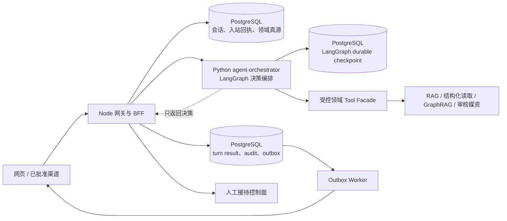
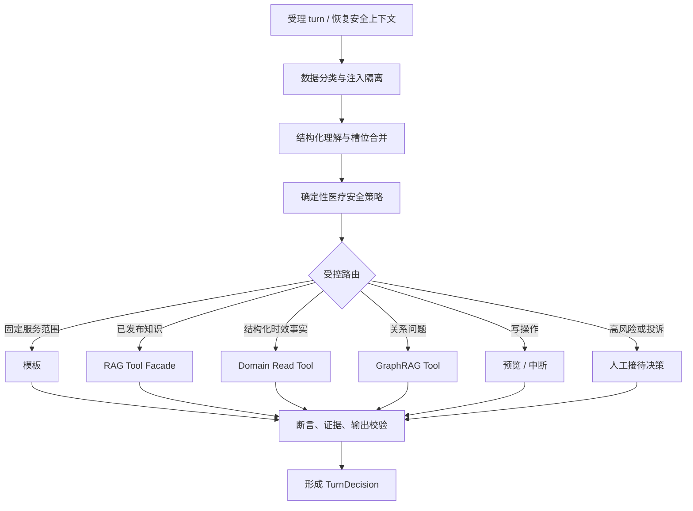

# 华美一期售前智能体 LangChain / LangGraph 重构技术设计（修订版）

**版本：** V2.0（技术评审修订稿）

**日期：** 2026-09-04

**状态：** 仅批准 R0 契约冻结与原型验证；P0 验收关闭前，不得接入真实客户数据或开展对客灰度

**适用分支：** `refactor/langchain-langgraph`
**替代范围：** 本稿替代原设计中关于运行时提交、检查点、人工确认、灰度与生产准入的描述；既有 Node.js 对外契约、领域数据、知识发布和人工接待能力继续保留。

## 0. 修订结论与不变边界

本次重构采用“**Node.js 网关与领域真源保留 + Python LangGraph 编排服务新增 + 已有知识、GraphRAG、人工接待及审计服务复用**”的渐进方案。LangGraph 用于可恢复的**决策编排**，不替代领域事务、授权、审计、渠道投递和人工接待控制面。

以下原则不变：

- Node.js 保留渠道协议、身份认证、限流、幂等入口、管理后台 BFF、领域命令、会话真源、审计与对外投递责任。
- Python `agent-orchestrator` 只产生受约束的 `TurnDecision`；不得直接向客户发送消息、直接写业务表或绕过现有领域权限。
- 价格、活动、排班、预约状态等时效事实只经受控的结构化领域工具读取；不得从向量文本或模型记忆推断。
- GraphRAG 不是默认路径；正式索引、租户、发布版本、证据链任一校验失败时，必须失败关闭并降级为已发布 RAG、固定安全话术或人工核验。
- 写操作必须经过“收集 → 预览 → 确认 → 执行”状态机。未接入的外部系统必须返回“未连接/待人工处理”，不得模拟成功。
- 售前智能体不是诊断、处方或个体化治疗服务。医疗风险、投诉、紧急不良反应、孕哺/未成年人/禁忌证等高风险情形优先进入确定性安全策略与人工路径。

本设计只定义技术实现与验收边界，不构成医疗执业、互联网诊疗或法律合规结论；涉及业务、医务和合规审批的事项须由相应责任人正式确认。

## 1. 重构目标、阶段准入与非目标

### 1.1 重构目标

在不破坏既有前台、管理后台、会话 API 和渠道接入契约的前提下，逐步将 Node 内部对话决策替换为 LangGraph 状态机，以解决：

1. 多轮槽位、用户纠正、待选择项和会话恢复的一致性问题；
2. 路由、知识版本、证据和人工接管决策的可追溯性问题；
3. 写操作、确认、超时、重试和渠道投递的可恢复性问题；
4. 模型、知识、策略、工具与评测结果的可复现性问题。

### 1.2 本阶段非目标

- 不将自由循环 ReAct Agent 作为售前主路径。
- 不把客户聊天、病例、联系方式、面部/术前术后图片或内部经营资料写入通用向量库、GraphRAG 输入或模型评测集。
- 不以 Shadow 双跑、开发回归、演示渠道或本地索引作为生产验收结论。
- 不在本次重构中重写既有客户、预约、价格、知识发布、人工接待或权限领域模型。

### 1.3 阶段性 Go / No-Go

| 阶段 | 可做事项 | 明确禁止事项 | 退出条件 |
| --- | --- | --- | --- |
| R0：契约冻结 | 状态、API、迁移、数据生命周期与测试设计；模型兼容原型 | 真实客户数据、渠道发送、真实写工具 | 本稿第 14 节 P0 用例全部通过 |
| R1：离线原型 | 合成数据、脱敏回放、仅只读工具的图实现 | 真实客户 Shadow、真实人工接待、预约写入 | Node ↔ Python 契约与故障恢复测试通过 |
| R2：受控 Shadow | 经审批的最小化/脱敏流量或回放，比较规范化决策 | 写工具、外发、真实接待创建、缓存回写 | 差异评测、隐私审查、模型成本及 SLO 基线通过 |
| R3：小流量对客 | 固定会话粘滞的受控 cohort | 未批准知识、未接通的外部渠道、未验收图谱 | 预生产真实模型、正式知识版本和人工值班演练通过 |
| R4：扩量 | 5% → 25% → 50% → 100% 的会话级灰度 | 跨版本硬切、绕过停止门槛继续放量 | 各阶段错误预算、回滚演练和签字完成 |

## 2. 责任边界与目标架构



### 2.1 服务职责

| 服务 | 负责 | 不负责 |
| --- | --- | --- |
| Node 网关 / BFF | 渠道入站、认证、租户/会话归属、幂等回执、会话顺序、领域命令、原子提交、外发、人工接待控制、对外 API 兼容 | 医疗语义决策、图内编排 |
| `agent-orchestrator` | 受限状态图、结构化理解、策略路由、只读工具计划、回复草案、引用与 `TurnDecision` | 渠道发送、宽泛数据库访问、领域真源写入、管理端授权判断 |
| Tool Facade | 受版本约束的 RAG、GraphRAG、价格、排班、预约、媒资、人工接待命令适配 | 由模型决定租户、权限或 SQL |
| PostgreSQL 领域库 | 会话、入站回执、状态、写操作、审批、审计、outbox 和受控读模型真源 | LangGraph 的内存缓存 |
| PostgreSQL Checkpoint Schema | LangGraph 技术恢复与中断游标 | 业务审计、渠道投递真源 |
| Redis | 限流、短缓存、租约、去重加速、队列辅助 | 唯一恢复来源、唯一审批记录、长期事实 |

### 2.2 信任边界

1. `tenant_id`、主体、角色、会话所有权和数据用途只由 Node 服务端认证结果派生；模型输出、客户端正文和 GraphState 中同名字段均不可作为授权依据。
2. Node 与 Python 必须同时使用私网网络策略、服务工作负载身份和受众绑定的短期服务令牌；“仅同一私网”不能替代服务身份校验。
3. Python 不获得业务超级用户数据库权限。只读查询经受限 Tool Facade 或租户受限只读视图；写操作只能经 Node 领域命令和 outbox。
4. 所有缓存键至少包含 `tenant_id`、权限/用途版本、数据/知识版本和语言；任何无法确认作用域的缓存命中一律失效。

## 3. 会话 Turn 提交协议（P0）

LangGraph checkpoint 是可恢复计算状态，不是会话、回复、人工接待或渠道投递的领域真源。每个用户消息必须遵循以下提交协议。

### 3.1 领域记录与唯一约束

| 记录 | 关键字段 | 约束 / 用途 |
| --- | --- | --- |
| `conversation_inbox` | `tenant_id, channel, upstream_message_id, payload_hash, turn_seq` | `(tenant_id, channel, upstream_message_id)` 唯一；保存入站回执与单调 `turn_seq` |
| `conversation_session` | `state_version, next_turn_seq, next_commit_seq, engine_pin, handover_epoch` | 每会话顺序、运行版本和人工接管栅栏的权威状态 |
| `turn_result` | `message_id, turn_seq, decision_hash, status, run_id, checkpoint_id` | `(tenant_id, message_id)` 唯一；保存已准备或已提交的规范化决策 |
| `pending_action` | `action_id, action_hash, version, actor_scope, expires_at, status` | 客户确认、取消、过期与执行的权威状态 |
| `effect_ledger` | `effect_id, idempotency_key, command_type, result_hash` | 外部副作用的业务幂等与结果回放 |
| `audit_event` | `event_id, turn_id, run_id, effect_id, redacted_summary` | 追加式审计；不以 checkpoint 替代 |
| `outbox_event` | `event_id, aggregate_id, delivery_state, receipt` | 对客投递的唯一真源和重试入口 |

`thread_id` 必须是不可枚举、无 PII 的服务端生成值，并由映射表强绑定 `tenant_id + channel + conversation_id + engine_epoch`。禁止直接将用户手机号、外部渠道 ID 或可猜测的会话 ID 用作 LangGraph `thread_id`。

### 3.2 状态转换

```text
received
  → accepted (写入 inbox 并分配 turn_seq)
  → leased (单会话执行器获得 fencing token)
  → prepared (得到已校验 TurnDecision / checkpoint)
  → committed (Node 在同一领域事务写入结果、会话、审计、接待或 outbox)
  → delivered | delivery_retry | dead_letter

任何阶段可进入 failed / expired；failed 只能由同一 message_id、相同 payload_hash 在当前 next_commit_seq 上恢复。
```

### 3.3 执行与并发规则

1. 网关先在 PostgreSQL 接收和去重，再调用编排服务；不在 LLM 调用期间长时间持有数据库行锁。
2. 同一 `(tenant_id, conversation_id)` 同时只能有一个有效短租约；租约携带递增 `fencing_token`。过期执行器即使完成图，也不得提交或投递。
3. 调用编排服务必须绑定：`message_id`、`payload_hash`、`turn_seq`、`expected_state_version`、`fencing_token`、`engine_pin` 和 `authorization_context_hash`。
4. `TurnDecision` 在 Node 执行 compare-and-set 成功前是“prepared”，不是对客户可见的最终回复；失败重试优先读取既有 `turn_result`，不得无条件重新调用模型。
5. 同一消息可重放图计算，但所有对外可见效果必须通过 `effect_ledger` 与 `outbox_event` 幂等执行。
6. 任何响应分段实际发送前，outbox worker 必须再次核对 `handover_epoch`、会话模式和 delivery fencing token。

### 3.4 原子提交边界

Node 在一个领域事务中完成以下写入：

- `turn_result` 从 `prepared` 变为 `committed`；
- 会话摘要、槽位和 `state_version` 的受控更新；
- 必要的 `pending_action` 或人工接待任务；
- `audit_event`；
- 对外消息或前端通知的 `outbox_event`。

LangGraph Checkpoint 可以在图执行中单独持久化，用于恢复；它不能单独证明领域提交或渠道已发送。Redis 只能缓存 checkpoint/租约结果，不能作为 resume 或领域恢复来源。

## 4. 内部接口契约

Node 与 Python 的接口采用版本化 JSON Schema / Pydantic 契约，并保留 consumer-driven contract tests。所有请求都限制字段长度、媒体数量、总字节数和超时时间。

### 4.1 `POST /internal/v1/orchestrate`

**用途：** 为一个已被网关接受的 turn 生成只读、可提交的 `TurnDecision`。

```json
{
  "contract_version": "2026-09-04.1",
  "turn": {
    "tenant_id": "derived-by-gateway",
    "conversation_id": "opaque-id",
    "message_id": "unique-message-id",
    "turn_seq": 42,
    "payload_hash": "sha256",
    "expected_state_version": 18,
    "fencing_token": 91,
    "engine_pin": {
      "engine": "langgraph",
      "graph_version": "v1",
      "state_schema_version": "v1"
    }
  },
  "input": {
    "redacted_message": "最小化后的文本",
    "attachment_refs": ["approved-asset-or-quarantine-ref"],
    "language": "zh-CN"
  },
  "authorization_context": "short-lived-signed-server-token",
  "trace": { "trace_id": "gateway-generated" }
}
```

**禁止传入：** 原始后台管理员令牌、模型 API Key、未隔离的联系方式/病历/面部图片、可由客户端覆盖的角色或租户字段。

### 4.2 `TurnDecision`

编排服务只返回以下受控结果，不能返回自由的数据库更新语句或任意 `state_patch`：

```json
{
  "status": "prepared | interrupted | policy_blocked | retryable_error",
  "run_id": "opaque-run-id",
  "checkpoint_id": "opaque-checkpoint-id",
  "decision_hash": "sha256",
  "conversation_update": {
    "safe_summary_ref": "reference-only",
    "slot_updates": [],
    "state_schema_version": "v1"
  },
  "response": {
    "segments": [],
    "citations": [],
    "media_asset_ids": [],
    "suggested_next_step": ""
  },
  "handover": null,
  "pending_action_preview": null,
  "evidence": { "release_id": null, "snapshot_id": null },
  "policy": { "decision": "allow | clarify | handover | block" }
}
```

### 4.3 确认恢复接口

`POST /internal/v1/resume-approval` 仅由 Node 在确认校验成功后调用。普通用户新消息不得自动成为 `Command(resume=...)`。

请求至少包含：`action_id`、`action_version`、`action_hash`、`thread_id`、`checkpoint_id`、`confirmation_nonce`、经网关验证的主体/授权范围、`fencing_token` 和新的幂等键。

服务端必须返回以下明确状态：

| 状态 | 语义 |
| --- | --- |
| `committed` | 已完成领域提交或获得可投递结果 |
| `interrupted` | 仍待确认或待人工，尚未执行外部效果 |
| `stale_sequence` | 会话顺序或 fencing token 已失效 |
| `policy_blocked` | 策略、权限、数据版本或医疗边界阻断 |
| `retryable_error` | 未提交，可按同一幂等键读取/安全重试 |
| `conflict` | 同一 key 使用不同 payload、确认已被取消或版本不一致 |

## 5. LangGraph 状态与检查点

### 5.1 版本化状态模型

```text
ConversationState v1
├── meta: thread_id, run_id, turn_id, turn_seq, graph_version, state_schema_version
├── request: tenant_ref, channel, message_ref, received_at, authorization_context_hash
├── context: redacted_summary_ref, recent_message_refs[max=8], active_topic, current_goal
├── understanding: intents, entities, slots, correction_tombstones, risk_signals
├── routing: route, freshness_required, tool_plan, data_snapshot_refs
├── evidence: citation_refs, claim_refs, release_id, index_version, checksum
├── decision: response_draft_ref, handover_candidate, action_preview_ref
├── governance: policy_decision, policy_release, trace_id, audit_ref_ids
└── runtime: checkpoint_id, deadline_at, retry_class, engine_pin
```

原始附件、全文聊天、长检索结果、原始工具输出、联系方式、病历、面部/术前术后图片不得写入 GraphState；状态仅保存经授权的引用、内容哈希、短期脱敏摘要和必要窗口。

### 5.2 字段所有者与 reducer

| 字段 | 唯一写入方 / reducer | 约束 |
| --- | --- | --- |
| 用户纠正与槽位 | `state_merge`；按 `turn_seq` 覆盖，写入 correction tombstone | 模型不得覆盖更晚的用户纠正 |
| 风险等级 | `safety_policy` 单调升级 | 不允许较低风险节点降级 |
| 引用与证据 | `evidence_validator` 按 `citation_id` 去重 | 必须绑定 release / snapshot |
| 审计引用 | `audit_adapter` 去重追加 | 仅保存 ID |
| 最近上下文 | `context_compactor` 环形上限 | 超额只保留安全摘要引用 |
| 工具结果 | `tool_adapter` 写入短期引用 | 无原始客户敏感内容 |

所有状态字段必须定义 schema、最大长度、TTL、数据分类、写入方和删除策略。若图未来引入并行节点，写同一字段必须先定义 reducer；未定义 reducer 的并行更新为错误。

### 5.3 Checkpoint 策略

- 使用 PostgreSQL 作为唯一 durable checkpointer；Redis 只做可丢失缓存或短租约。
- Checkpoint 存于独立 schema、最小权限数据库角色、加密与行级租户约束之下。
- 每个 checkpoint 记录 `graph_version`、`state_schema_version`、`policy_release`、`prompt_release`、`tool_contract_version` 与内容大小。
- 设定线程级体积上限、保留期、归档/删除流程和备份恢复测试。审计记录不因 checkpoint 裁剪而丢失。
- 发布采用 add-then-remove：旧字段与旧节点至少保留一个会话排空周期；扫描 paused/interrupted/busy 线程后才允许删除兼容路径。

## 6. 节点、路由与医疗安全策略



### 6.1 不可绕过的安全门

在任何模型生成前，独立策略节点必须处理：

- 紧急不良反应、意识/呼吸风险、严重疼痛/出血等紧急信号；
- 自伤风险、未成年人、孕哺、禁忌证、既往严重疾病或术后异常；
- 医疗诊断、处方、个体化治疗承诺、疗效/风险保证；
- 投诉、激烈负面情绪、隐私请求、越权身份查询；
- 文件恶意内容、提示词注入、外部链接/工具参数污染。

策略输出只能为：固定安全答复、澄清、人工接待、拒绝或受控知识路径。低置信度不得直接回退为自由医学生成；“已转人工”不得承诺即时响应。

### 6.2 路由原则

| 问题类型 | 首选路径 | 必须满足的约束 |
| --- | --- | --- |
| 问候、服务范围 | 固定模板 | 已审批话术；不虚构渠道或服务能力 |
| 一般售前科普 | 受控模型 + 已审批边界 | 不作诊断/处方/个体承诺；涉及临床断言必须有批准证据 |
| 医生、项目、产品、医院服务 | 已发布 RAG | 当前租户、当前发布集、可点击引用 |
| 价格、活动、名额、排班、预约状态 | Domain Read Tool | 权限、有效期、`as_of` 与 data version 校验 |
| 医生—项目—产品关联 | GraphRAG Tool | 已准入索引、证据可回溯、净化分类词输入 |
| 图片、PDF、海报 | 审核媒资工具 | 返回授权资产 ID 与短期签名预览，不返回任意 URL |
| 投诉/高风险 | 人工接待控制面 | 创建可认领任务、最小化上下文和 SLA，不宣称已处理 |
| 预约、报名、工单 | Pending Action 工作流 | 预览、确认、幂等执行、可取消/补偿 |

### 6.3 工具隔离

模型只能提出工具计划；独立策略与 Tool Facade 负责授权和执行。每个工具必须具备：具名输入/输出 schema、主体/租户/用途校验、超时、幂等性、数据快照标识、允许字段、输出大小上限、审计事件与错误分类。

检索片段、OCR、上传文件、媒资说明和工具输出均视为不可信数据。它们只能作为数据内容，不能改变系统策略、角色、租户范围、模型指令或工具权限。

## 7. 知识、GraphRAG 与证据

1. 知识继续执行“解析 → 去重 → 科室审核 → 医务/合规审核 → 发布”版本化流程；原始层只读，发布层可回滚。
2. RAG 只读取当前租户、当前生效、允许客户展示的发布集；来源、权限、审核人、有效期、撤回状态与版本必须可追溯。
3. GraphRAG 从同一发布快照构建实体、关系、来源段落、有效期和版本。每条图关系必须回指批准知识单元和原文片段。
4. `release_id + index_version + checksum + tenant_id + active_release_binding` 必须一致；任一不一致、正式索引未准入、返回证据无效时，GraphRAG 失败关闭。
5. GraphRAG Tool 的输入是批准的项目/医生/部位/关系维度或净化后的查询指纹，不得直接转发客户原话、联系方式、病史或自由附件文本。
6. 对客户展示的医院事实、价格、医生/产品关联均需断言—证据映射。无充分证据、来源过期或无法验证时，返回核验/人工路径而非强答。
7. 发布切换必须创建不可变快照；新索引先评测和压测，切换后保留旧版本以回滚。支持按 release、资产、医生或项目紧急撤回。

## 8. 写操作、确认恢复与人工接待

### 8.1 写操作状态机

```text
collect → previewed → customer_confirmed → executing → executed
             │              │                    │
             └→ cancelled / expired / stale_data ┴→ failed / compensation_pending
```

`previewed` 不是已执行。`pending_action` 至少绑定：

- `action_id`、canonical `action_hash`、`action_version`；
- 会话、已认证主体、租户、用途和权限快照；
- 结构化数据 `expected_version`、知识/政策版本和 `expires_at`；
- 一次性 `confirmation_nonce`、取消版本、幂等键；
- 预览文本引用、补偿方式、执行结果和 effect ledger 引用。

执行前必须重新校验授权、确认 nonce、未过期、会话 fencing token 和 `expected_version`。信息变化时返回“信息已变化，请重新确认”；不得按旧预览执行。

`interrupt()` 只允许在纯计算或已持久化、无外部副作用的预览之后使用。实际创建预约、推送外部系统、发送通知和写领域数据均在确认后的独立命令节点中完成，并使用业务幂等与 outbox。

### 8.2 人工接待控制面

会话权威模式为 `ai | handoff_pending | human | closed`。人工接待状态为 `created → queued → acknowledged → owned → resolved`。

- 创建任务时只传递完成接待所需的最小化上下文、已授权字段、证据与风险标签。
- 坐席认领时，Node 在同一事务中将会话切至 `human`、提升 `handover_epoch`、取消未完成 approval、抑制在途 AI run 与 outbox 待发 AI 回复。
- 人工接待不使用无限等待的图作为队列。图返回交接决策后可终止；后续认领、完成、恢复 AI 均由领域控制面驱动。
- 若队列不可用、SLA 超时或值班不可确认，返回真实的安全提示，不伪称已由人工处理。

## 9. 数据安全、隐私与生命周期

### 9.1 数据分类与允许流向

| 数据类别 | 模型 / GraphState | RAG / GraphRAG | 日志 / 评测 | 存储与保留 |
| --- | --- | --- | --- | --- |
| 常规售前文本 | 仅最小化、脱敏后按批准用途 | 仅用于检索语义，不做事实真源 | 脱敏摘要 | 会话策略规定的最短期限 |
| 联系方式、身份信息 | 令牌/引用，不传原文 | 不进入 | 不进入普通日志 | 联系方式保险库、用途绑定、加密 |
| 病历、健康、术后异常 | 默认不进入；仅安全分类信号 | 不进入通用库 | 不进入 | 受控隔离、人工处理 |
| 面部、前后对比、病例附件 | 默认隔离；不进 checkpoint | 不进入 | 不进入 | 审核媒资/隔离存储、短期签名访问 |
| 价格、排班、活动 | 只传必要结果及版本 | 不作为向量事实 | 仅版本和哈希 | 结构化领域真源 |
| 审计 / Bad Case | 只保留 ID、哈希、脱敏摘要 | 不适用 | 权限隔离后可复核 | 独立保留与删除传播机制 |

### 9.2 模型出域控制

- 每个模型调用记录数据分类、用途、供应商/区域、模型版本、批准编号、token 预算和调用结果哈希。
- 未完成数据出域、供应商条款、零保留/不得训练、密钥责任与删除路径确认前，禁止真实客户文本进入模型或 Shadow。
- 附件先经过类型/大小限制、恶意内容扫描、隔离、OCR 审核和人工准入；仅批准的派生摘要可进入后续流程。
- 追踪、调试和外部可观测平台默认不传原始提示词、证据全文或工具输出；需要调试时使用受控、限时、脱敏快照。

### 9.3 注入、XSS 与媒资控制

- 对用户输入、文件/OCR、检索片段和工具输出实施来源标识与不可信内容隔离。
- 前端只渲染 schema 化消息段；HTML 转义、URL allowlist、媒资 ID allowlist、短期签名 URL、响应大小/类型限制均在服务端执行。
- 模型不能访问任意 URL、任意文件路径、通用 SQL 或管理端令牌。

## 10. 模型与 LangChain 适配层

### 10.1 依赖与版本

生产镜像使用 Python 3.12，并锁定 `langgraph`、`langgraph-checkpoint-postgres`、`langchain-core`、`langchain-openai`、`pydantic`、`FastAPI` 及其哈希。每次升级必须运行图恢复、结构化输出、工具调用与 checkpoint 兼容回归。

### 10.2 Qwen 适配要求

- 在配置中显式锁定 `model_id`、provider endpoint、区域、API 版本、`enable_thinking`、超时、重试策略、最大 token、费用上限和出域开关。
- `with_structured_output` 不是兼容性假设。R0 必须以目标 Qwen 模型、目标 endpoint 和实际 Pydantic schema 运行 live contract test；失败时使用经验证的 JSON mode + parser/repair fallback，或失败关闭。
- 结构化输出只校验形状，不等于医学风险、意图或事实正确。关键安全分类必须有确定性规则和独立评测。
- 模型、Prompt、System Policy、Tool schema、知识发布和评测数据集均需版本化；每个 `TurnDecision` 保留其版本引用。

### 10.3 成本与可用性

- 调用前按 `tenant + model + day` 原子预占额度，调用后按实际用量结算；80%/100% 告警不能替代硬限额。
- 只重试幂等读调用，并依照错误类型区分模型限流、超时、格式错误、依赖不可用和策略阻断。
- 设置每节点 deadline、整轮 deadline、并发 semaphore、单会话队列、熔断器与降级矩阵。客户端断连必须取消未提交 run；已提交 outbox 由后台可靠投递。

## 11. 可观测性、评测与 SLO

### 11.1 可复现追踪

每个 turn 至少关联：`trace_id`、`run_id`、`thread_id_hash`、`checkpoint_id`、`turn_seq`、`engine_pin`、部署镜像 digest、图/状态/Prompt/Policy/Tool/模型版本、知识/结构化数据快照、approval/effect/outbox ID、输入输出哈希和失败分类。

运行日志、受控调试快照和不可篡改领域审计必须分层存放；回放默认 `dry-run`，绝不重新执行真实写工具或渠道投递。

### 11.2 路由级 SLO 与容量

| 路由 | 指标口径 | 初始验收要求 |
| --- | --- | --- |
| 固定模板 / 欢迎语 | 网关端到端 P95 | ≤ 2 秒 |
| GraphRAG 检索层 | 检索服务 P95，不含客户原话 | ≤ 2 秒 |
| 完整售前链路 | 网关到可投递结果 P95，包含排队、模型、检索与提交 | ≤ 10 秒，真实模型预生产实测后确认 |
| 写操作 | 预览响应与异步执行分别统计 | 不承诺同步外部执行成功 |

模型启用前的历史压测不能替代真实模型、正式知识发布、完整副本监控下的容量验收。每条 SLO 必须记录冷/热缓存、模型 429、队列长度、依赖失败、长会话和人工接管竞争场景。

### 11.3 评测与阻断门槛

评测工件必须固定 `dataset_id`、标签规范、样本分层、版本、执行环境、模型/Prompt/知识版本和签名结果。常规指标以外，以下属于阻断项：

- 已验证医疗红旗、隐私越权、跨租户、非授权写操作、人工接管后 AI 外发：**0 漏放**；
- 医院/价格/医生/产品等对客企业事实：无批准证据不得发布；
- GraphRAG 未准入、证据/发布版本不一致：必须失败关闭；
- Shadow 发现任何真实写入、接待创建、渠道投递或缓存污染：立即停止；
- 关键指标必须按风险类别、渠道、语言、会话长度和缓存状态分桶，不能只报告总平均值。

回归集至少覆盖：重复 webhook、乱序双消息、多端同时确认、节点崩溃、checkpoint 恢复、过期/撤销确认、手工接管与 AI 完成竞争、模型/Redis/PostgreSQL/GraphRAG 故障、跨版本恢复、回滚、附件/OCR 注入和 outbox 重投。

### 11.4 后台知识素材到知识图谱的准入链路

管理后台必须以“原始素材”而不是可直接对客检索的文本作为入口。管理员上传只创建受控素材记录，系统在隔离区校验文件大小、MIME、二进制签名和指纹；原始文件、OCR/PDF 解析结果和审核意见均不得被前台智能体直接检索。

```text
管理员上传原始素材
  → 隔离保存 / 受控解析
  → 科室确认 → 业务审核 → 医务审核 → 合规审核
  → 知识库候选池（生成候选记录号）
  → 发布负责人创建不可变知识发布快照
  → GraphRAG 构建任务消费同一快照
  → 索引评测、索引负责人绑定 manifest
  → 发布人激活知识版本与图谱版本
```

“同步更新知识图谱”指创建与知识发布快照绑定的增量构建任务，不指单条资料通过后立即改写在线图谱，更不指自动切换当前对客版本。GraphRAG 构建必须复用发布版本、记录清单校验和、三方审核回执和索引 manifest；任一项缺失、模型出域未授权、预算告警未配置或评测未通过时，任务保持阻塞，对客检索继续使用当前已激活版本。

开发环境可使用受保护的本地隔离存储验证流程；测试和生产环境必须改用对象存储加密、PostgreSQL 审计记录、生命周期/删除传播和最小权限访问，不能把本地文件路径、原始文件或未审核解析文本暴露给浏览器或模型。

## 12. 会话级灰度、迁移与回滚

### 12.1 Engine Pin

每个会话在首轮或安全迁移点写入不可变 `engine_pin`：

```json
{
  "engine": "legacy | shadow | langgraph",
  "graph_version": "v1",
  "state_schema_version": "v1",
  "prompt_release": "approved-release",
  "policy_release": "approved-release",
  "tool_contract_version": "v1"
}
```

后续 turn 必须按 pin 路由。全局 `HUAMEI_AGENT_ENGINE` 仅作为新会话默认值或紧急熔断；不得把正在进行的会话在 legacy 与 LangGraph 之间硬切。

### 12.2 Shadow 规则

Shadow 只允许：只读工具白名单、隔离 idempotency namespace、同一输入/策略/知识 release/结构化数据快照、脱敏审计与规范化决策比较。

Shadow 禁止：写领域数据、创建真实人工接待、预约/工单、渠道投递、联系信息披露、缓存/会话摘要回写和对客户可见输出。

比较优先级为：路由、风险等级、槽位、引用、是否转人工、动作预览与政策结论；不以自然语言文案差异作为唯一评判依据。

### 12.3 回滚与迁移

- 采用“扩展字段 → 双读/显式转换 → 新会话切流 → 观察期 → 清理旧字段”迁移。
- 无法无损转换的 `pending_slot`、`pending_action`、`handover` 或暂停图线程继续旧引擎或转人工。
- 回滚前扫描 `prepared/interrupted/executing` 状态，明确取消、恢复、人工接管或过期方案；不得只切环境变量。
- 每个灰度阶段定义最短样本、最短持续时间、自动停止门槛、on-call 负责人、回滚 runbook 和演练记录。

## 13. 建议目录

```text
agent-orchestrator/
  app/
    api/                 # versioned internal schemas and endpoints
    graph/               # state.py, graph.py, nodes/, subgraphs/, migrations/
    adapters/            # qwen and controlled Tool Facade clients
    policies/            # medical safety, release, evidence, output validation
    persistence/         # Postgres checkpointer only; checkpoint retention
    observability/       # redacted tracing, metrics, dry-run replay
    tests/               # unit, state, contract, recovery, load, safety
  pyproject.toml
  uv.lock or equivalent lock file
  Dockerfile

node-domain/
  conversation-turn/    # inbox, fence, commit, recovery, engine pin
  pending-action/       # preview, confirmation, command, effect ledger
  outbox/               # delivery and dead-letter handling
  contracts/            # Node ↔ Python consumer-driven contracts
```

## 14. 开始 R1 前的 P0 验收清单

1. `Turn Commit Protocol` 的 PostgreSQL 迁移、唯一约束、顺序/租约/fencing 属性测试通过。
2. Node ↔ Python 的 OpenAPI/Pydantic schema、错误码、payload 上限和 consumer-driven tests 通过。
3. `interrupt` 恢复、重复确认、取消、过期、数据变更重预览、命令幂等和 outbox 重投通过。
4. 人工接管与在途 AI 完成竞争测试证明：接管后不存在 AI 渠道外发或旧确认执行。
5. 状态 schema、checkpoint 版本、迁移/回滚与暂停线程演练通过。
6. 敏感数据流、模型出域、日志/评测脱敏、附件隔离与删除传播获得业务、医务、合规和安全确认。
7. Qwen 目标模型的结构化输出、工具调用、超时、限流和费用控制 live contract test 通过。
8. GraphRAG 保持现有的正式索引准入、发布快照、租户、证据、净化查询和失败关闭约束。
9. 预生产完成真实模型、正式知识发布、20 并发稳态、故障注入、监控全副本汇总与人工值班演练，并保留可审计证据。

## 15. 参考实现语义

- LangGraph `interrupt` 会在恢复时重新执行中断节点，因此中断前不得存在非幂等副作用；实现必须将预览与执行分离。
- LangGraph durable checkpoint 记录图状态，适用于恢复，但不替代业务事务、审计和渠道投递确认。
- Qwen 的 OpenAI 兼容接口和结构化输出能力须以实际模型/区域/模式测试为准；不能仅依赖 SDK 方法名推断可用性。
