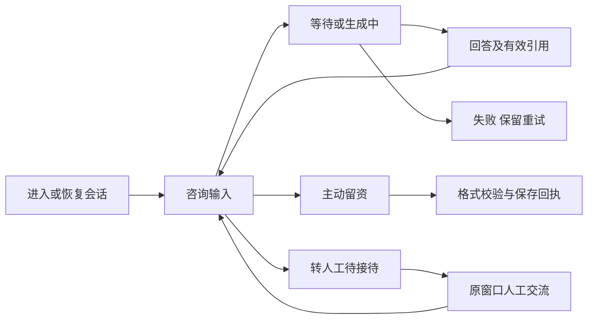
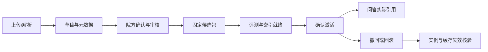

# 页面流程与交互状态目标

下列为目标流程和验收草图，依据现有代码入口及用户反馈整理，不是已经完成的设计稿或本轮浏览器截图。真实页面截图由开发者用本机模拟数据补入交付证据。布局沿用当前视觉体系，不要求全量换框架。

## 1. 客户咨询



输入区在新消息到达时保持草稿与焦点；阅读历史不强制滚底。客户主动留资优先确认真实保存结果，并继续当前问题。等待人工不能显示已接通，完整电话不放气泡回显。A负责页面，B提供状态与送达回执。

## 2. 人工接待工作台

```
[会话搜索/筛选] | [客户与接管状态、负责人] | [客户资料/常用语]
[客户甲 红点2]  | [有序消息、来源、时间]   | [脱敏电话、查询状态]
[客户乙 红点1]  | [阅读历史/新消息提示]    | [联系偏好、预约摘要]
[当前客户高亮]  | [当前客户草稿输入]      | [话术插入，不自动发送]
               | [接管/发送/结束/恢复AI] |
```

选中客户不因其他人消息而跳转；消息更新只影响相关区域。发送按钮区分未接管、发送中、已提交、投递失败；没有渠道读回执不显示客户已读。冲突显示当前负责人并禁用无权操作。

## 3. 客户及预约

客户列表→授权详情→联系方式短时查看→联系偏好与备注→预约意向→确认改期/取消。详情保留来源会话链接。会员错误与未找到记录不同标签；禁止联系偏好固定展示。预约卡显示期望日期和跟进状态，不显示未实际锁定的专家号源。

## 4. 资料与发布



草稿保存、提交审核、构建候选、激活是不同按钮。激活确认展示目标版本与替换范围；撤回后标记历史引用不可继续使用。表单失败保留输入，版本冲突不能静默覆盖。

## 5. 登录、权限与错误状态

登录→服务端身份→允许菜单→业务页面。401清理身份并安全回登录；403显示权限不足，不无限跳登录。退出后旧会话失效，并停止推送/轮询。

| 状态 | 用户可见内容 | 操作及禁止事项 |
|---|---|---|
| 首次加载 | 骨架或加载说明 | 不显示假空列表 |
| 无数据 | 明确暂无记录 | 可新增/调整筛选，不显示错误 |
| 请求失败 | 原因摘要、重试 | 保留输入和已显示数据，不假成功 |
| 无权限 | 权限说明与可访问入口 | 服务端仍拒绝，不能只隐藏按钮 |
| 保存成功 | 真实版本/记录回执 | 局部更新，不整页重载 |
| 状态冲突 | 最新状态/负责人/版本 | 重新确认，不能静默覆盖 |
| 未保存离开 | 丢弃或继续编辑选择 | 不自动发送草稿 |
| 手机窄屏 | 面板切换、输入可见 | 不让软键盘遮挡发送 |

证据要求：每个页面至少正常、空、失败、无权限四态；关键写操作另加冲突和重复提交。截图中的姓名、手机号与材料必须为模拟数据。
