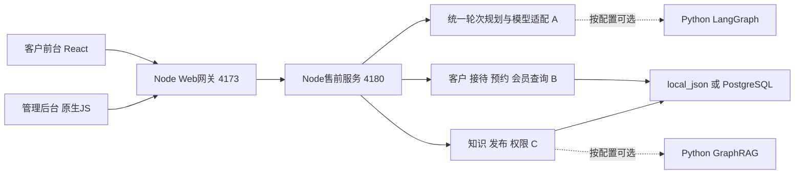

# 技术栈、框架与共同开发约定 V1.0

日期：2026-09-10。依据共同代码基线 `e47b57e0f64a3694f09b25e29c5b440666624013`，标签 `team-baseline-20260910-v1`。以下版本从仓库声明、锁文件及代码核对，不是“最新版本推荐”，也不代表线上实际部署版本。本次只补充开发文档，不修改或移动已冻结的基线。

## 1. 实际架构与启用状态

| 层次 | 实际技术/版本 | 当前状态与用途 | 依据 |
|---|---|---|---|
| 客户前台 | JavaScript/JSX、React 19.2.0、React DOM 19.2.0、Vite 6.4.2、plugin-react 5.0.4 | `/advisor/`；组件状态与fetch；没有独立Redux或路由框架依赖 | apps/acquisition-advisor/package.json、package-lock.json、src/App.jsx |
| 管理后台 | 原生JavaScript ES Modules、HTML、CSS、hash路由 | src/app.js等集中处理渲染和事件；本次仍需增量拆模块 | src/app.js、src/subpages.js、src/operations-client.js |
| Web网关/BFF | Node.js >=22，node:http | 本地4173端口、静态页面、公开与后台API；现有路由不是Express/NestJS | package.json、server.mjs、server/api-router.mjs |
| 售前领域服务 | Node.js ES Modules、原生HTTP | 本地4180；对话规划、知识调用、业务编排与回执 | server/acquisition-service-server.mjs、server/acquisition-orchestration.mjs |
| 模型适配 | Node fetch、兼容Chat Completions的HTTP协议 | 统一规划/理解/生成调用；基线team:init默认LLM关闭；需自行配置授权开发模型 | server/llm-client.mjs、scripts/team-init.mjs |
| 默认编排 | 自研Node流程，HUAMEI_AGENT_ENGINE=legacy | legacy是引擎名称，不代表只能规则回答；是否调用模型另受LLM配置控制 | server/acquisition-orchestration.mjs、.env.example |
| 可选编排 | Python >=3.12、FastAPI、Pydantic、LangGraph、LangChain Core/OpenAI适配 | agent-orchestrator代码存在；基线默认未启用，不能当作已接管所有对客轮次 | agent-orchestrator/pyproject.toml、requirements.lock、README.md |
| Python编排锁版本 | LangGraph 0.6.11、langchain-core 0.3.86、langchain-openai 0.3.35、langgraph-checkpoint-postgres 2.0.25、FastAPI 0.141.1 | 来自开发锁文件；pyproject范围另有声明。不是本次重装或生产安装证明 | agent-orchestrator/requirements.lock |
| 开发存储 | local_json、被Git忽略的本机状态 | team:init默认；便于无数据库起步；不能替代PostgreSQL验收 | scripts/team-init.mjs、server/persistence/ |
| 数据库 | pg 8.23.0驱动；Compose声明PostgreSQL 16-alpine | 已有SQL迁移、租户上下文、RLS及事务适配；需独立配置测试数据库 | package-lock.json、deploy/local/compose.yml、db/migrations/ |
| 缓存/限流 | redis 6.2.1客户端；Compose声明Redis 7-alpine | 服务端基础设施；声明存在不等于开发基线已启动Redis | package-lock.json、deploy/local/compose.yml |
| 默认知识检索 | 公开知识目录、Node本地哈希特征向量+词项匹配 | local-hashing-zh-v1，并非外部语义Embedding模型或独立向量数据库 | server/huamei-knowledge.mjs、server/runtime-knowledge-index.mjs |
| 可选GraphRAG | graphrag 3.1.1、FastAPI 0.141.1、uvicorn 0.52.4、orjson 3.12.0、httpx 0.28.1 | Python独立服务；基线默认关闭；索引、数据授权与就绪须独立验收 | graphrag-service/requirements.txt、app/、scripts/team-init.mjs |
| 文件与媒体 | ali-oss 6.23.0及现有本地/对象存储适配 | 文件prepare/content/complete及资料访问；不得把密钥放浏览器 | package-lock.json、server/knowledge-intake-store.mjs |
| 消息更新 | 后台EventSource/SSE + 有退避轮询；前台fetch完整JSON回复 | SSE已存在不等于完整消息重放已验收；前台reply_segments不是真正token流 | src/app.js、apps/acquisition-advisor/src/App.jsx |
| 测试 | Node .mjs测试脚本/断言，部分node:test；Python unittest | 不强行替换为Jest/Vitest；浏览器操作另记证据 | tests/、scripts/team-verify.mjs、agent-orchestrator/tests/ |
| 部署素材 | Docker Compose、Caddy、可选worker/观测配置 | 由负责人统一集成发布，三人不各自改线上 | deploy/、server/workers/ |

所有依赖升级先申报，连同锁文件交付。Python声明范围、开发锁与GraphRAG固定依赖要分别管理，不混入同一个未经验证的虚拟环境。

## 2. 数据与调用边界



图中的A/B/C表示业务归属，不表示三个独立代码仓库。所有人拿完整仓库；共用入口按handoff/ownership.json申报变更。数据库写入、预约、会员调用和人工投递由受控业务服务执行，模型不能仅靠自然语言宣布成功。人工接管状态在最终提交前再校验。

基线提供924条公开开发知识记录；原始客户聊天、真实手机号、生产密钥及正式发布状态不随包发放。一般业务测试用假资料、mock接口。真实模型/数据库/院方通路的验收分别记录，不以本地模拟通过替代。

## 3. 三人技术责任

| 人员 | 主要技能与代码层 | 框架使用要求 | 本轮重点 |
|---|---|---|---|
| A | React/JSX、Node、结构化模型输出、多轮状态、评测 | 沿用React/Vite和Node模型适配；LangGraph列为P2独立方案 | 统一理解、上下文、留资承接、自然表达与前台体验 |
| B | 原生JS后台、Node、SSE/HTTP、SQL/事务、幂等及业务适配 | 沿用后台及存储层；前台人工消息展示与A共同完成 | 同一会话、消息送达、人工竞态、客户/会员/预约闭环 |
| C | 原生JS后台、Node、SQL/RLS、资料生命周期；可选Python检索 | 默认本地索引与发布准入先做好；不要求本轮切GraphRAG | 发布生效/撤回、证据版本、五岗位及对象权限 |

`agent-orchestrator/`在V1 ownership中未明确分给A，A-030仅表示方案/业务责任；涉及该目录仍按未知路径申报shared_changes。`src/app.js`、`server/api-router.mjs`、共用鉴权、迁移、依赖、部署和新契约都属共享变更，不能整文件覆盖。不要为方便A/B/C并行而各自另建一套登录、客户库或会话状态。

## 4. 启动与验证

在从原基线bundle克隆的独立目录，先切自己的feature/A或B或C分支。版本要求及详细交付见原共同交付规范。

```bash
npm ci
npm --prefix apps/acquisition-advisor ci
npm run team:init
npm run team:build
npm run team:verify
npm run dev
```

默认前台 `http://127.0.0.1:4173/advisor/`，后台登录 `http://127.0.0.1:4173/login`。team:init只生成本机测试账号，不覆盖已有配置。模型、院方查询、GraphRAG、自动外发默认关闭，知识为preview；需要真实联调再配置各自开发凭据。切换端口同时调整Origin白名单和领域服务URL。

| 人员 | 已存在的建议命令 | 限制 |
|---|---|---|
| A | npm run test:turn-planning；npm run test:presales-dialogue；npm run team:verify | 真实模型另跑并记录模型与知识版本；test:acquisition-eval默认coverage不代表真实质量得分 |
| B | npm run test:member-check；npm run test:acquisition-orchestration；npm run team:verify | 人工送达必须浏览器联调；会员默认mock，真实院方查询另验 |
| C | npm run test:admin-session；npm run test:phase-one-boundary；npm run test:phase-one-core；npm run team:verify | 发布跨进程、PostgreSQL/RLS和真实索引另验 |
| 负责人 | npm run test:postgres-isolated（有隔离数据库配置时） | 不指向生产库，不把local_json结果替代数据库测试 |

本次文档编制核验命令是否存在，不重新宣称所有这些测试本轮已执行。上次基线验证范围仍以BASELINE_VERIFICATION.md为准。

## 5. 开发前需要一起冻结的接口

现有路径以contracts/gateway-openapi.baseline.json、contracts/acquisition-openapi.baseline.json及实际路由为依据。快照不完整覆盖所有UI内部接口；先核对实现再补充。下表是本次的目标对接要求，字段命名若与现状不同应做兼容映射，不直接替换线上协议。

| 编号 | 提供方→消费方 | 目标内容 | 关联Story |
|---|---|---|---|
| IF-01 | B→A | conversation/message标识、来源、服务端顺序、提交与投递状态、幂等回执 | B-003/004、A-001/003 |
| IF-02 | B→A | 客户留资回执、脱敏显示、联系人关联；accepted/invalid/failed独立于会员结果 | B-015/019、A-018/019 |
| IF-03 | B→A | 人工pending/human/恢复状态、版本、负责人、消息回读；提交前拦截AI | B-009/010/011/012、A-022/023 |
| IF-04 | B→A | 预约意向ID、状态、期望时间、expected_version、确认来源、改期/取消回执 | B-023/024/025、A-021 |
| IF-05 | C→A | 授权证据ID/版本/内容/范围/有效状态、空结果与错误分离、最终有效性检查 | C-014/015、A-014 |
| IF-06 | C→B | principal、role/capability、tenant/department/object scope、失效及拒绝语义 | C-026/027、B-028 |
| IF-07 | C→B | 可用话术分类、版本、变量和撤回状态 | C-018、B-013 |
| IF-08 | A/B协作 | 新增流式事件schema、序号、final/error/cancel、最终持久化回执；须兼容现有JSON | A-005、B-004/011 |

每份契约附成功、失败、重复、版本冲突和无权限样例，并标哪些字段现有、哪些新增。冻结接口可以先交付mock和契约测试，不必等另一人的完整界面完成。

## 6. 优先级、阶段与完成定义

P0：核心闭环和正确性，本轮优先；P1：主要交互与运营增强，P0稳定后接续；P2：框架迁移等可选增强。它们是规划优先级，不能解释为代码现在全部缺失。所有Story初始为“待逐项核验”；开发者先复现，再标已有通过、需修复、需新增或受阻。

| 阶段 | A | B | C | 合入条件 |
|---|---|---|---|---|
| S0 契约与现状核验 | IF-01～05消费端、坏例基准 | IF-01～04/06接口与mock | IF-05～07、角色矩阵 | 对齐字段、错误与文件归属；每个故事有现状结论 |
| S1 核心可用 | A-002、006～020、024、026、028的P0 | B-003～007、009～012、015～025的P0 | C-003～015、019～027的P0；C-031环境准备 | 本模块成功/异常/权限测试及P0回归；小批次交付 |
| S2 联调与交互收口 | 会话恢复、预约与人工前台、移动端/流式等P1 | 完成后台入口、预约处理、B-028～030与P1 | C-016、029、032与P1、正式持久化验证 | 完整旅程实际演示，三人共同修复接口和状态问题 |
| S3 后续增强 | A-030 LangGraph方案与受控接入 | 并发、恢复及渠道能力按实测缺口拆分 | 可选GraphRAG评估和索引建设 | 另立任务，不能仅因已有依赖而强行上线 |

此表是依赖驱动的顺序，不是承诺工期；92条Story不意味着92天或能在一个短迭代全部完成。P0较多，应按可验收小批次滚动安排，建议每1～2个工作日交付可运行增量。界面抽取、协议冻结属于前置工程任务，不能挤掉业务验收。

每条Story的完成必须包括：代码提交与基线ID、实现/复用说明、验收条件逐项结果、异常与反向权限证据、关联测试、共享文件/接口/迁移说明、已知限制与回退。截图只证明界面，不能代替服务端回执；mock只证明适配逻辑，不能代替真实接口通路。

状态建议：待逐项核验→已有通过/需修复/需新增/受阻→开发中→待联调→待验收→通过。受阻写明缺失条件和负责人；不自动算通过。

## 7. 交付追溯

继续使用原team:deliver/team:inspect工具，V1基线提交与标签保持不变。本次清单作为补充需求包发送，无需重新发代码基线。每个任务报告summary标注Story ID；tests中用证据路径记录AC结果。若跨多个Story，在附加story_results中记录对应关系；保留原模板必需字段。

```json
{
  "story_results": [
    {"story_id":"A-006","status":"待验收","commit":"实际提交号","cases":["TC-A-006-AC1"],"evidence":"测试报告路径","limitations":[]}
  ]
}
```

以上只是报告可增加的字段示例，不是替代完整report-template.json。跨人依赖列表也包含共同验收关系；不是全部必须串行完成的前置任务图。
